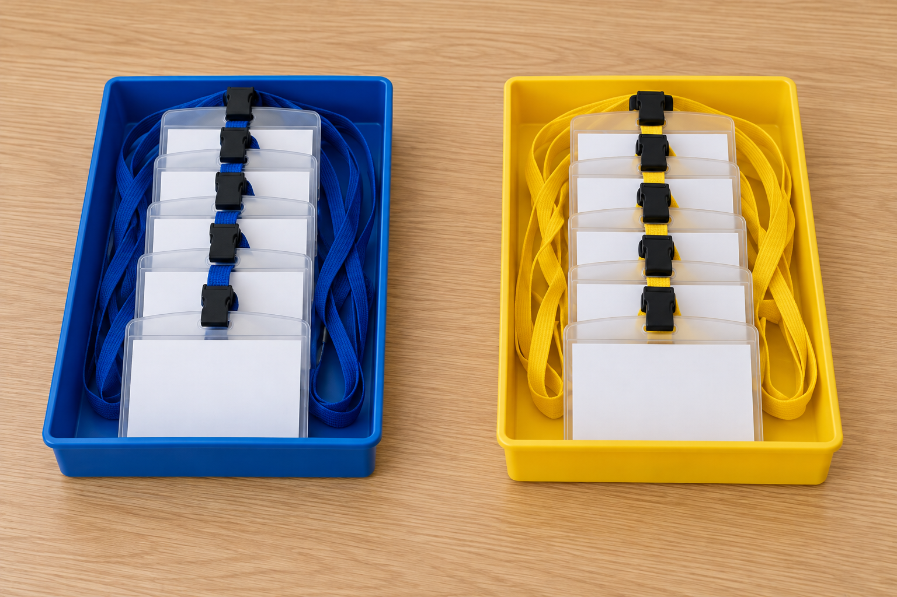
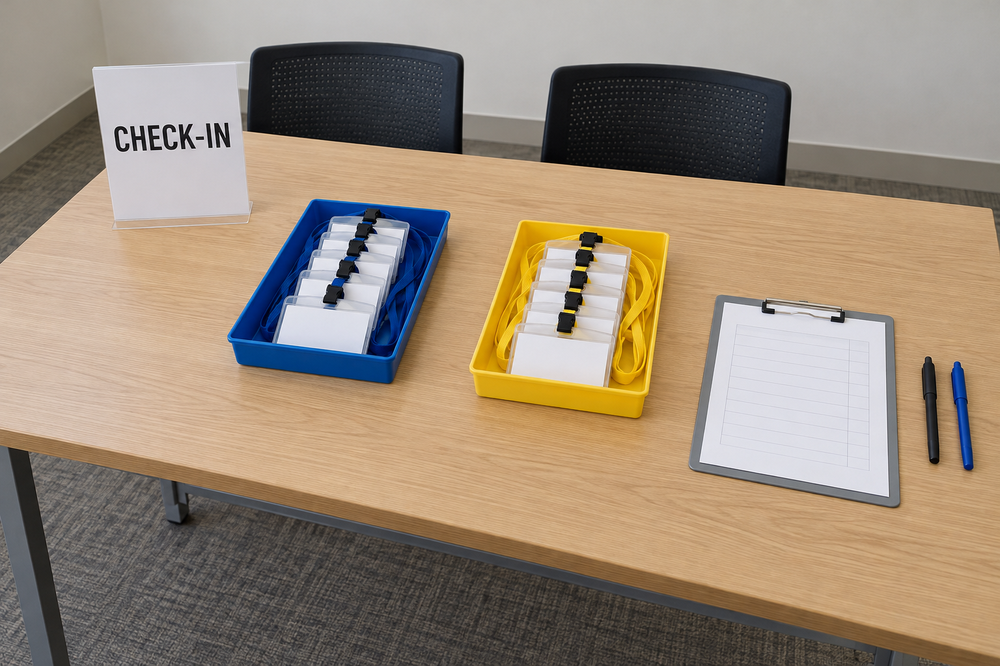

# ShowMe 3분 시연 — 파란 보관표와 행사 접수대 안내서

**11월 3일 갱신:** 아래 최종 대본은 3분 기준이다. 공개 소스 저장소·접근 가능한 영상·행사 중 개발한 범위를 함께 준비한다. 제출 마감은 한국 시간 2026년 11월 5일 11:00(11월 4일 21:00 EST)이다. [공식 안내](https://cerebralvalley.ai/e/meta-ai-developer-hackathon/details#7-submission-process-15). [최종 비평](FINAL_SUBMISSION_CRITIQUE.md).

기준: 2026년 11월 1일. 해커톤 시연을 위해 만든 가상 행사 운영 시나리오입니다. 이미지 4장은 image_gen으로 만든 AI 연출 자료이며 실제 행사 촬영 사진이나 현장 사용자 평가 자료가 아닙니다. ShowMe의 설명 생성·질문 답변은 실제 Meta API를 사용합니다.

## 시연이 보여줄 문제

비슷하게 생긴 표가 두 종류 있고, 한 표의 발급 조건을 다른 표에 적용하면 안 됩니다. 첫 장면은 파란 트레이의 보관표를 가리켜 장비를 대여할 수 있는지 묻는 상황입니다. 이어 행사 접수대 안내서로 전환해 담당자가 사진 안내를 작성하고 승인하는 과정을 보여줍니다.

## 준비된 결과물

- **파란 보관표 승인본**은 `python3 scripts/seed_demo.py --scenario storage-tags`로 만든 뒤 [로컬 데모](http://127.0.0.1:8765/demo)에서 연다. 접수대 데모의 연출 사진을 재사용한다. 자세한 실행법은 [README](../README.md)에 있다.
- **접수대 4단계 승인본**은 옵션 없이 `python3 scripts/seed_demo.py`로 만든다. 촬영에 두 승인본이 필요하면 준비 명령이 각각 출력한 `/learn/…` 주소를 사용한다. `/demo`는 마지막으로 준비한 시나리오를 연다.
- [작성 화면](http://127.0.0.1:8765/)에서는 접수대 데모를 바탕으로 만든 별도 촬영용 초안을 사용한다.
- 외부 공개 배포와 영상 촬영은 완료된 것으로 기록하지 않습니다. 로컬 링크는 서버를 실행한 이 컴퓨터에서만 열립니다.

## 4단계 안내서와 등록할 메모

### 1. 접수 안내판 세우기

파일: 01-sign.png

행동 메모: CHECK-IN 안내판을 접수대 왼쪽에 세워 참가자가 접수 위치를 알 수 있게 합니다. 글자가 참가자 쪽을 향하는지 확인합니다.

승인 설명: 접수대 왼쪽에 CHECK-IN 안내판을 세웁니다. 참가자가 접수 위치를 알 수 있도록 글자가 참가자 쪽을 향하는지 확인합니다.

완료 확인: CHECK-IN 글자가 보이고 안내판이 접수대 왼쪽에 세워져 있습니다.

### 2. 서명 도구와 운영자 펜 구분하기

파일: 02-signing-tools.png

행동 메모: 검은 펜은 참가자 서명용이고 파란 펜은 운영자 메모용입니다. 회색 클립보드 오른쪽에 두 펜을 준비하고 색상을 구분할 수 있는지 확인합니다.

승인 설명: 회색 클립보드 오른쪽에 검은 펜과 파란 펜을 구분해 준비합니다. 참가자 서명에는 검은 펜을 사용합니다. 파란 펜은 운영자 메모용으로만 사용합니다.

완료 확인: 클립보드 오른쪽에 검은 펜과 파란 펜이 각각 보이고 서로 구분됩니다.

시연 수정 지점: 생성된 설명을 위 문장으로 수정해 사용할 사람과 용도를 분명히 합니다. 검은 펜의 강조 영역 아래쪽을 좁혀 물체에 맞춥니다. 이번 검증에서는 777 → 754로 보정했지만 다시 생성하면 좌표는 달라질 수 있으므로 사진을 보고 판단합니다.

### 3. 사전등록과 현장등록 명찰 분리하기

파일: 03-badge-trays.png

행동 메모: 파란 트레이에는 사전등록 참가자용 명찰을, 노란 트레이에는 현장등록 참가자용 명찰을 놓습니다. 사진 기준으로 파란 트레이는 왼쪽, 노란 트레이는 오른쪽입니다. 두 트레이 사이를 비워 서로 구분되는지 확인합니다.

승인 설명: 사진 기준 왼쪽의 파란 트레이에는 사전등록 참가자용 명찰을 놓습니다. 오른쪽의 노란 트레이에는 현장등록 참가자용 명찰을 놓습니다. 두 트레이 사이를 비워 구분합니다.

완료 확인: 왼쪽 파란 트레이와 오른쪽 노란 트레이가 서로 떨어져 보이고 각 명찰이 트레이 안에 있습니다.

### 4. 접수대 전체 배치 점검하기

파일: 04-overview.png

행동 메모: 접수대 왼쪽에 안내판, 중앙에 파란색과 노란색 명찰 트레이, 오른쪽에 서명용 클립보드와 검은 펜 및 운영자용 파란 펜이 있는지 확인합니다. 참가자가 설 수 있도록 접수대 앞쪽 왼편을 비워 둡니다. 사진으로 작업 완료를 자동 판정하지 않고 담당자가 직접 점검합니다.

승인 설명: 왼쪽의 CHECK-IN 안내판, 중앙의 파란색·노란색 명찰 트레이, 오른쪽의 클립보드·검은 펜·파란 펜을 확인합니다. 참가자가 설 수 있도록 접수대 앞쪽 왼편을 비워 둡니다. 배치를 직접 점검한 뒤 완료 표시합니다.

완료 확인: 안내판·두 트레이·클립보드·두 펜이 보이고 접수대 앞쪽 왼편이 비어 있습니다.

## 3분 시연 대본 — 파란 보관표부터 시작

`showme-final-rc`의 화면으로 촬영한다. 첫 컷은 두 트레이가 보이는 승인본이다. 아래 시간은 편집본 기준이며, 촬영은 세 클립으로 나눈다. 모델 호출이 끝날 때까지 원본 화면을 계속 녹화하고, 편집에서 대기를 줄인 구간에는 **‘대기 구간 단축’**을 표시한다.

| 편집 시간 | 화면과 행동 | 내레이션 |
| --- | --- | --- |
| 00:00–00:10 | **클립 A** · 보관표 사진으로 시작한다. 두 트레이를 함께 보여준다. | “교육을 받은 신입이 이 표로 장비를 가져가려고 합니다. 그런데 두 표의 용도와 발급 규칙이 다릅니다.” |
| 00:10–00:32 | 왼쪽 파란 트레이의 맨 앞 흰색 표를 가리킨다. SAM 윤곽 → ‘교육을 받았으니까 이 표로 장비를 가져가겠습니다.’ 전송 → 실제 금지 제목. | “SAM 3.1이 가리킨 표의 윤곽을 잡습니다. Muse Spark가 승인 규칙을 대조합니다. 파란 표는 보관용이라 장비를 대여할 수 없습니다.” |
| 00:32–00:55 | 제목과 승인 원문을 보여준다. 금지 근거와 ‘다른 대상에 적용되는 기준’을 차례로 짚는다. | “교육 이수나 책임자 동행은 노란 장비 대여표의 발급 조건입니다. ShowMe는 그 조건을 따로 표시하고 담당자가 승인한 원문을 그대로 보여줍니다.” |
| 00:55–01:25 | **클립 B** · 노란 표를 선택한다. 책임자 동행을 명시한 허용과 조건을 생략한 유보 화면을 차례로 보여준다. 두 응답은 각각 새 질문으로 촬영한다. | “노란 표는 책임자 동행이 확인된 상황이라면 발급할 수 있습니다. 같은 표라도 발급 조건을 알 수 없으면 조건을 더 확인하라고 안내합니다.” |
| 01:25–01:55 | **클립 C** · 접수대 작성 화면. 미리 준비한 사진·행동 메모 → 한 단계 실제 AI 초안 생성 → 설명·완료 기준 검토. | “담당자가 사진과 행동 메모를 넣으면 Muse Spark가 초안을 작성합니다. 담당자가 작업 지시와 완료 기준을 확인합니다.” |
| 01:55–02:23 | 나머지 단계가 검토된 상태에서 마지막 단계 검토 → 전체 승인본 생성 → 학습 링크 열기. | “승인하면 사진, 순서, 문장이 한 버전으로 고정됩니다. 학습자는 링크에서 승인된 절차를 봅니다.” |
| 02:23–02:49 | 같은 안내서의 초안 한 문장을 수정·저장한다. 별도 탭의 직전 승인본을 새로고침해 기존 문장을 확인한다. | “이후 초안을 바꿔도 이미 전달한 승인본은 그대로입니다. 작업자는 자신이 본 절차와 답변 근거를 다시 확인할 수 있습니다.” |
| 02:49–03:00 | 파란 보관표 판정과 ShowMe 이름을 보여준다. 공개 링크가 정해지면 최종 카드에 넣는다. | “ShowMe는 사진에서 가리킨 물체를 승인된 작업 규칙에 연결합니다. 이 시연에는 AI 연출 사진과 실제 Meta 모델 응답을 사용했습니다.” |

### 촬영 전 준비

- 카메라에 담을 세 화면을 연다. **A**는 보관표 승인본, **B**는 같은 승인본에서 노란 표를 선택할 탭, **C**는 접수대 작성 화면이다. C에서 발행한 링크는 같은 안내서의 초안을 수정하기 전에 별도 탭에 열어 둔다.
- A는 왼쪽 파란 트레이 맨 앞 흰색 표 가운데, B는 오른쪽 노란 트레이 맨 앞 흰색 표 가운데를 누른다. B의 질문은 순서대로 ‘교육은 받지 않았지만 책임자가 동행하고 있습니다. 이 표를 발급해도 되나요?’와 ‘이 표를 발급해도 되나요?’다.
- C는 미생성 단계에 사진과 행동 메모를 넣고 나머지 단계는 미리 검토한다. 생성 실패 시 승인 문구를 준비한 별도 초안에서 검토·발행을 촬영하고 **‘미리 준비한 문구’**라고 표시한다. 생성이 성공하면 설명·완료 확인·강조를 실제로 확인하고 검토한다.
- 촬영은 브라우저 창이나 제품 화면 영역만 담는다. 첫 컷 전 화면과 마이크를 짧게 점검하고, 비밀번호·키·설정 파일과 개인 알림이 화면에 없는지 확인한다. 세 클립을 붙인 뒤 영상이 3:00 이내인지 확인한다.

### 대기와 실패에 대비한 실제 화면

호출이 실패하면 제품이 보여주는 오류와 입력 보존 상태를 확인하고, 같은 질문을 다시 촬영한다. 시간이 부족하면 아래 화면을 **‘사전 실제 실행’**으로 표시해 사용할 수 있다. 수정한 Docker 이미지에서 같은 세 질문을 실제로 실행한 화면이다.

- [파란 보관표 금지](assets/storage-tags-docker-blocked-fixed.png)
- [노란 대여표 허용](assets/storage-tags-docker-allowed-fixed.png)
- [노란 대여표 판단 유보](assets/storage-tags-docker-conditional-fixed.png)

## 질문과 확인할 결과

1. 보관표: “교육을 받았으니까 이 표로 장비를 가져가겠습니다.” → 파란 보관표 금지 근거가 제목에 나오고 노란 표의 발급 조건이 별도 표시된다.
2. 접수대 3단계: “현장등록 참가자용 명찰은 어느 트레이에 있나요?” → 오른쪽 노란 트레이, 승인된 설명 인용과 사진 위치.
3. 접수대 2단계: “이 펜은 어디에 있나요?” → 검은 펜인지 파란 펜인지 확인. “검은 펜이요.” 또는 검은 펜 선택 → 클립보드 오른쪽의 검은 펜 위치.
4. 접수대 2단계: “행사 시작 시간은 몇 시인가요?” → 모르겠습니다, 사진·승인 설명에 근거가 없다는 안내, 새 강조 영역 없음.

## 리허설과 대기 상황

전체 흐름을 보여줄 때는 새 안내서를 만들어 4장을 등록합니다. 반복 연습은 ‘리허설 · 행사 접수대 준비’에서 수정·검토부터 시작할 수 있습니다. 이 경우 사진과 AI 초안을 미리 준비했다고 밝힙니다.

응답 대기 시간은 실제 상태로 보여줍니다. 지연·호출 실패 시 기존 입력과 승인된 안내서를 계속 볼 수 있음을 설명하고 준비된 완성본으로 이동합니다. API 응답을 고정된 대본으로 바꾸거나 오류를 정상 응답처럼 설명하지 않습니다.

## 남아 있는 작업

- [ ] 실제 시연 영상 촬영·편집
- [x] 공식 안내와 실제 제출 폼에서 공개 GitHub·3분 영상·설명·Meta 활용 항목 확인(11월 3일)
- [ ] 영상 언어 제한의 별도 공지 여부 및 최종 공개 링크 접근 재확인
- [ ] 외부에서 접근할 배포 주소 준비
- [ ] 실제 사용자 효과 검증 — 사용자 결정으로 이번 제출의 필수 조건에서 제외

## 원본 자료와 실행 준비

이미지·담당자 메모·승인 문구·강조 위치는 `public/demo/reception-setup/`에 있습니다. 전체 자료 묶음은 `public/demo/reception-setup-demo.zip`입니다. 생성에 사용한 최종 프롬프트 4개는 `image-prompts.json`, 자료 출처와 해시는 `photo-sources.json`입니다. 이미지 생성은 내장 image_gen 도구, 서비스의 설명 생성과 질문 답변은 실제 Meta API를 사용했습니다.

시연 전 서버를 실행하고 작성자 로그인을 확인합니다. API 키나 비밀번호 파일은 촬영 화면에 열지 않습니다. ‘리허설 · 행사 접수대 준비’는 실제 최초 AI 초안을 복사한 미승인 연습용이므로 완료된 승인본 링크를 바꾸지 않고 수정·검토를 연습할 수 있습니다.

## 이번 데모의 실제 검증 결과

브라우저에서 새 안내서 생성 → 이미지 4장 등록 → 담당자 메모 입력 → 실제 Meta API 4회 초안 생성 → 제목·설명·강조 영역 수정 → 4단계 검토 → 전체 승인본 → 참여자 질문을 실행했습니다.

질문 API 4회는 승인된 명찰 용도 답변, 모호한 펜 확인 질문, 검은 펜 선택 후 위치 답변, 행사 시작 시간 정보 부족 응답입니다. 모두 기대한 상태를 확인했습니다. 생성·질문 합계 8회, 평균 모델 응답 5.969초, 사용량 합계 32,362토큰입니다. 응답 문구와 시간은 실제 시연 때 달라질 수 있습니다.

사진·설명·강조 위치는 이 가상 운영 시나리오의 작성자 검토 내용입니다. 기존 다른 안내서의 승인본 저장 문자열은 변경되지 않았습니다. 실제 현장 사용자 검증이나 영상 촬영 완료를 뜻하지 않습니다.

로컬 검증 자료: state/evidence/event-demo-implementation.json, event-demo-draft-generated.json, event-demo-approved-draft.json, event-demo-grounded-answer.png, event-demo-followup-answer.png, event-demo-unknown-answer.png, event-demo-approved-overview.png.

## 11월 2일 추가 시연: 이름을 몰라도 사진에서 선택

1. 승인본의 2단계 ‘서명 도구와 운영자 펜 구분하기’를 엽니다.
2. ‘사진에서 물체 선택’ → 오른쪽 파란 펜의 가운데를 누릅니다. 파란 윤곽이 표시되는 것을 보여줍니다.
3. ‘이 물체는 무엇에 쓰나요?’ → ‘파란 펜은 운영자 메모용으로만 사용합니다’ 인용을 확인합니다.
4. ‘이 펜으로 참가자 서명을 받아도 되나요?’ → 검은 펜으로 받으라는 답변과 각각의 승인 문구를 보여줍니다.
5. ‘이 펜은 어느 브랜드이며 언제 구매했나요?’ → 근거가 없으므로 모른다고 답합니다.
6. 선택 해제 시 승인 사각형이 돌아오는 것을 확인하고, ‘이 펜은 무엇에 쓰나요?’라고 물으면 검은/파란 펜을 구분하는 확인 질문을 보여줍니다.

위 흐름은 실제 Meta API와 브라우저에서 확인했습니다. 응답 시간·문구는 달라질 수 있습니다. 시연 사진은 AI 연출 이미지이며 현장 사용자 검증은 아닙니다. [선택 기능 검증 기록](SELECTION_RESULTS.md).

[실제 제출 폼에 맞춘 소개문·남은 제출 자료](SUBMISSION_PACKET.md).
