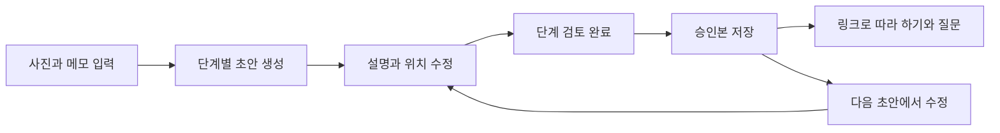

# ShowMe 핵심 기능 기획

2026년 11월 1일 작성. ShowMe로 진행한다는 사용자 결정과 [실제 API 검증](../experiments/meta-vision/RESULTS.md)을 바탕으로 정한 제품 명세입니다. 사진 한 장의 [첫 구현](FIRST_SLICE_RESULTS.md)에 이어 최대 6단계 입력·순서 편집·단계별 검토·전체 승인·학습 진행을 구현했습니다. 현재 구현 범위는 [다단계 검증 결과](MULTISTEP_RESULTS.md)를 참고하세요. 현재 단계의 질문·확인 대화·근거 표시도 구현하고 [실제 API와 브라우저에서 검증](QUESTIONS_RESULTS.md)했습니다. 외부 배포와 현장 사용자 평가는 후속 작업입니다.

## 제품 목표와 첫 사용자

숙련자가 사진과 짧은 메모로 작업 안내서를 만들고, 새 담당자가 그 안내서를 따라 하며 막힌 부분을 사진에 연결해 질문합니다. 성공 기준은 초보자가 원래 담당자에게 반복해서 물어보던 질문을 안내서 안에서 해결하고 작업을 마치는 것입니다.

첫 사용 시나리오는 행사 운영자가 신규 스태프에게 접수대 준비를 설명하는 상황으로 잡습니다. 대상은 한 명의 작성자와 안내서 링크로 접속하는 학습자입니다. 초기 언어는 한국어입니다. 조직·팀 관리와 다중 작성자 협업은 후순위입니다.

기존 공개 사진 3장은 개별 물체 인식 시험 자료입니다. 실제 접수대 작업 순서를 보여주는 연속 사진은 추가 확보해야 합니다. 첫 개발은 이미 검증한 사진 한 장과 담당자 메모로 전체 저장·승인·학습 흐름을 먼저 연결합니다.

## 검증 결과가 바꾼 제품 결정

| 확인한 사실 | 첫 버전의 결정 |
| --- | --- |
| 단일 사진에서 설명·대상 위치 출력을 확인 | 질문은 현재 단계의 사진과 승인된 설명을 대상으로 함 |
| 사각형이 물체보다 넓게 잡히는 사례 | 담당자가 영역을 다시 그리거나 지우고 승인할 수 있게 함 |
| 모호한 질문에 확인 질문 반환 | 추가 질문과 사용자의 답변을 같은 맥락으로 연결 |
| 없는 물체에 위치를 만들지 않음 | 보이지 않는 대상에는 강조 영역을 표시하지 않음 |
| 평균 응답 4.715초 | 대기 상태와 중복 요청 방지, 실패 후 입력 보존 |
| 여러 사진 간 선택·누른 위치 해석·절차 생성은 미검증 | 전 단계 검색과 사진 영역 선택 질문은 P1, 생성 정확성은 별도 검증 |

## 실제 사용 시나리오

### 담당자가 안내서를 만드는 과정

1. ‘행사 접수대 준비’라는 작업 제목과 목표를 입력합니다.
2. 준비물·안내판 배치·명찰 정렬·배부물·완성 상태 사진을 순서대로 등록합니다. 최종 지원 범위는 1~6단계입니다.
3. 사진마다 짧은 행동 메모를 입력합니다. 예: ‘명찰은 가나다순, 현장등록용은 오른쪽 트레이에 따로 둡니다.’
4. 단계별 ‘설명 초안 만들기’를 실행합니다. 사진과 메모를 바탕으로 제목·할 일·완료 확인 문장·강조 영역 후보를 만듭니다.
5. 설명과 강조 영역을 확인하고 필요한 부분을 수정합니다. 승인 전에는 ‘초안’입니다.
6. 모든 단계를 검토하고 ‘승인본 만들기’를 실행합니다. 저장된 승인본의 학습 링크를 복사합니다.

작업 순서와 업무 규칙의 출처는 담당자 입력입니다. 모델은 그 내용을 읽기 쉬운 단계로 정리하며, 사진에 없는 규칙을 추가하지 않습니다. 메모가 부족하면 질문 후보를 남기고 담당자가 내용을 보완합니다.

### 신규 스태프가 작업하는 과정

1. 링크를 열어 작업 목표·단계 수를 확인하고 시작합니다.
2. ‘2/5 안내판 배치’처럼 현재 단계의 사진과 설명을 봅니다.
3. ‘안내판은 어느 것인가요?’라고 입력합니다. 답변과 현재 사진의 해당 영역을 함께 봅니다.
4. ‘초록색 물건은 어디 있나요?’처럼 모호하면 ShowMe의 확인 질문에 답합니다. 앱은 원래 질문·확인 질문·추가 답변을 함께 전달합니다.
5. 자료에 없는 절차를 물으면 필요한 정보가 없다고 설명하고 담당자에게 확인할 질문을 보여줍니다.
6. 사용자가 단계 완료를 표시하고 다음으로 이동합니다. 모든 단계 표시 후 완료 화면을 봅니다.

‘완료’는 사용자의 체크 상태입니다. 사진으로 작업 성공을 판정했다는 의미로 표시하지 않습니다.

## 첫 버전의 범위

| 우선순위 | 기능 | 완료 조건 |
| --- | --- | --- |
| P0 | 사진·순서·메모 입력과 초안 저장 | 새로고침 후 사진·순서·메모가 유지됨 |
| P0 | 단일 단계 설명 생성 | 사진·메모를 근거로 구조화된 초안을 생성하고 실패해도 입력은 유지 |
| P0 | 설명·강조 영역 검토 | 텍스트 수정, 사각형 다시 그리기·삭제, 단계 검토 표시 가능 |
| P0 | 승인본 저장과 학습 링크 | 승인 시점을 고정한 읽기 전용 안내서를 별도 기기에서 열 수 있음 |
| P0 | 현재 단계 따라 하기 | 단계 이동·완료 표시·진행률, 같은 기기 새로고침 후 진행 복원 |
| P0 | 현재 단계 질문·근거 표시 | 해당 사진·설명에서 답변하고 모호함·대상 없음·정보 부족을 구분 |
| 구현 | 사진에서 선택한 물체 질문 | SAM 윤곽과 승인 설명 근거 답변 연결, 상세는 아래 최신 범위 |
| P1 | 안내서 전체에서 관련 단계 검색 | 여러 사진 근거 선택 검증 후 추가 |
| 구현/후속 | SAM 윤곽 강조 / 다국어 | SAM 구현·검증, 다국어는 후속 |

실시간 영상·음성·작업 완료 자동 판정·여러 작성자의 동시 편집은 이번 제출 범위에서 제외합니다.

## 화면과 상호작용

마케팅 페이지보다 작업 화면을 먼저 만듭니다. 화면 시각 스타일은 구현 시 조정하되, 사진과 행동 문장이 중심이 되도록 합니다.

| 화면 | 주된 내용과 행동 | 빈 화면·실패 상태 |
| --- | --- | --- |
| 안내서 목록 | 새 안내서 만들기, 초안 계속하기, 승인본 열기 | 안내서가 없으면 만들기 버튼과 샘플 시작 제공 |
| 작성 화면 | 단계 목록, 사진 미리보기, 메모, 위·아래 순서 이동, 저장 | 파일 오류는 해당 사진 옆에 표시, 기존 입력 유지 |
| 검토 화면 | 사진·강조 영역, 생성 설명·완료 확인, 수정, 단계 검토 표시 | 생성 실패 단계만 재시도, 다른 단계 결과 보존 |
| 승인본 미리보기 | 학습자 화면으로 확인, 승인본 생성, 링크 복사 | 미검토 단계가 있으면 단계로 이동하는 안내 |
| 따라 하기 | 단계 번호·사진·설명·질문 입력·이전/다음·완료 | 질문 실패는 재시도, 단계 이동과 기존 설명은 계속 사용 |
| 작업 완료 | 사용자가 체크한 단계, 다시 보기, 미해결 질문 목록 | 완료되지 않은 단계가 있으면 해당 단계로 이동 |

작성·검토는 넓은 화면에서 사진과 텍스트를 나란히, 학습은 휴대전화에서 위아래로 배치합니다. 기본 글자 16px 이상, 주요 터치 영역 44px 이상, 가로 스크롤 없이 사용합니다. 저장 상태는 ‘저장 중/저장됨/실패’로 표시합니다.

위치 편집은 복잡한 도형 편집기 대신 사각형 다시 그리기·삭제부터 제공합니다. 드래그가 어려운 사용자를 위해 대상 목록과 위치·크기 입력을 함께 제공하며, 조작 결과는 사진에서 즉시 확인합니다. 사진 확대·화면 크기 변경 시 강조 영역도 함께 맞춰집니다. 강조는 색상 외에 번호·이름으로 구분합니다.

질문 중에는 ‘사진과 설명을 확인하고 있어요’를 표시하고 같은 요청의 중복 제출을 막습니다. 완료 시 답변을 알리고 초점은 불필요하게 이동하지 않습니다. 오류는 질문 옆에서 설명하며 입력을 보존합니다. 완료 체크·이전/다음·기존 설명 읽기는 모델 응답 대기와 독립적으로 동작합니다.

## 상태와 승인 규칙

- 초안은 저장한 입력·생성 결과·검토 상태를 가집니다. ‘저장됨’과 ‘승인됨’을 구분합니다.
- 단계 설명·메모·사진·강조 영역이 바뀌거나 순서를 바꾸면 영향을 받는 단계의 검토 표시를 해제합니다.
- 설명·행동·완료 확인 문장이 채워지고 모든 단계가 검토돼야 승인본을 생성합니다. 강조 영역은 선택 사항입니다.
- 승인본은 해당 시점의 사진·설명·순서를 고정합니다. 이후 초안 수정으로 기존 승인본과 진행 중인 학습 화면을 바꾸지 않습니다.
- 새 승인본을 만들면 새 링크를 제공합니다. 학습 진행과 질문은 승인본 ID를 기준으로 구분합니다.
- 질문에 대한 AI 답변이 승인된 안내서 본문을 자동으로 수정하지 않습니다.

## 답변 정책

| 상황 | 사용자에게 보여줄 것 | 강조 영역 |
| --- | --- | --- |
| 사진·승인된 설명에 답이 있음 | 짧은 답변, 사진 또는 승인된 문장의 근거 | 물체 질문이고 위치가 유효할 때 표시 |
| 대상이 사진에 없음 | ‘이 사진에서는 보이지 않습니다’ | 없음 |
| 질문 대상이 모호함 | 구분할 수 있는 확인 질문 | 확인 전에는 없음 |
| 절차·규칙 정보가 부족함 | ‘이 안내서에는 설명이 없습니다’와 담당자 확인 질문 | 물체가 보여도 미확인 절차의 근거로 쓰지 않음 |
| 통신·형식 오류 | 다시 시도할 수 있는 오류 안내 | 새 강조 영역을 만들지 않음 |

사진에 물체가 보인다는 사실과 그 물체를 어떻게 사용해야 한다는 업무 규칙을 구분합니다. 출처 ID와 좌표의 형식 검사만으로 설명의 사실성이 보장되지는 않으므로 실제 질문 사례로 별도 평가합니다.

## 검증과 데모 완료 조건

첫 구현은 1단계에서 입력 → 생성 → 수정 → 승인 → 다른 화면에서 열기 → 질문까지 연결한 뒤 4~6단계로 확장합니다.

출시 전 확인할 핵심 사례:

1. 승인 후 초안에서 설명과 사진을 바꿔도 기존 학습 링크는 같은 내용을 보여줍니다.
2. 세로 촬영 사진과 휴대전화 화면에서도 강조 위치가 물체와 맞습니다.
3. 넓게 잡힌 상자를 담당자가 보정하고, 승인본·학습 화면에서 같은 위치를 봅니다.
4. 물체 없음·모호함·규칙 부족 사례에 그럴듯한 위치나 절차를 만들지 않습니다.
5. 생성·질문 실패 후 입력과 기존 승인본을 다시 사용할 수 있습니다.
6. 학습 링크로 초안을 수정하거나 미승인 사진을 읽을 수 없습니다.
7. 앱을 다시 열어 안내서를 조회하고 같은 기기에서 학습 진행을 복원합니다.

사용자 2~3명을 확보하면 정적 사진 안내서와 ShowMe로 유사한 작업을 수행하게 하고, 누락 단계·추가 질문·작업 시간을 기록합니다. 가능하면 사용 순서를 바꿔 학습 효과를 줄입니다. 아직 참여자가 확보된 상태는 아니며, 내부 시연과 실제 사용자 결과를 구분해 발표합니다.

데모는 담당자의 짧은 메모가 안내서가 되는 과정, 잘못된 강조 영역의 보정, 초보자의 질문에 물체가 표시되는 장면, 모호한 질문의 확인 과정을 보여줍니다. 영상 길이 등 제출 형식은 제출 폼에서 확인한 뒤 맞춥니다.

## 11월 2일 최신 범위: 사진 직접 선택

학습자가 현재 사진에서 물체를 누르면 SAM 윤곽을 표시하고, 선택한 대상을 현재 단계의 승인된 설명과 연결해 질문합니다. 클릭 전 ‘선택 모드’와 처리 중 대기를 분리하고, 선택 해제·재선택·키보드 조작을 제공합니다. 단계마다 선택과 질문을 분리하며 원래 단계에 늦게 도착한 결과가 다른 단계에 표시되지 않습니다.

선택한 물체의 용도·절차 답변에는 승인된 설명 또는 완료 확인의 문구 근거가 필요합니다. 사진만으로 업무 규칙을 만들거나 다른 대상·다른 단계의 규칙을 가져오지 않습니다. 물체 정체가 불분명하면 확인하고 규칙이 없으면 모른다고 답합니다. SAM 윤곽은 담당자 승인 내용이나 작업 완료 판정을 바꾸지 않습니다. [통합 검증과 제약](SELECTION_RESULTS.md).
